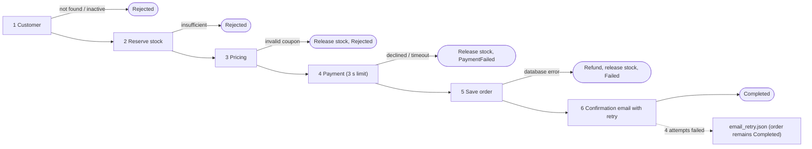
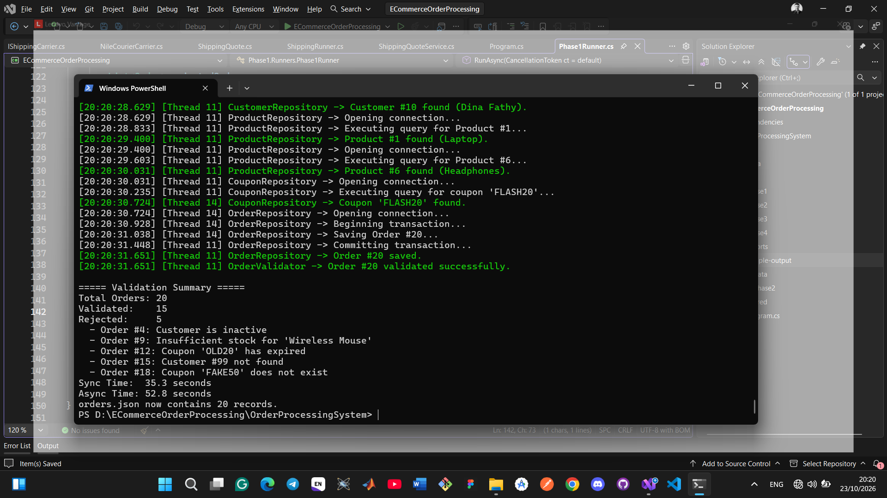
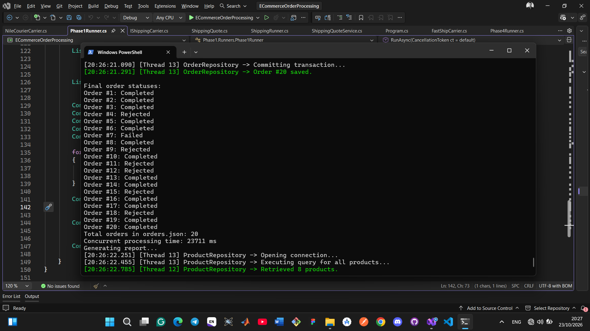
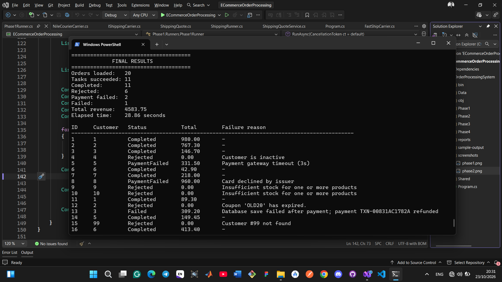
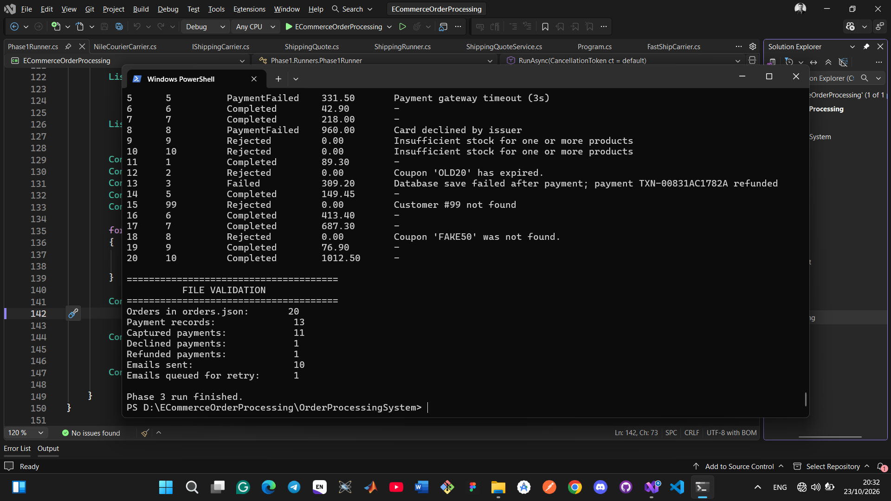
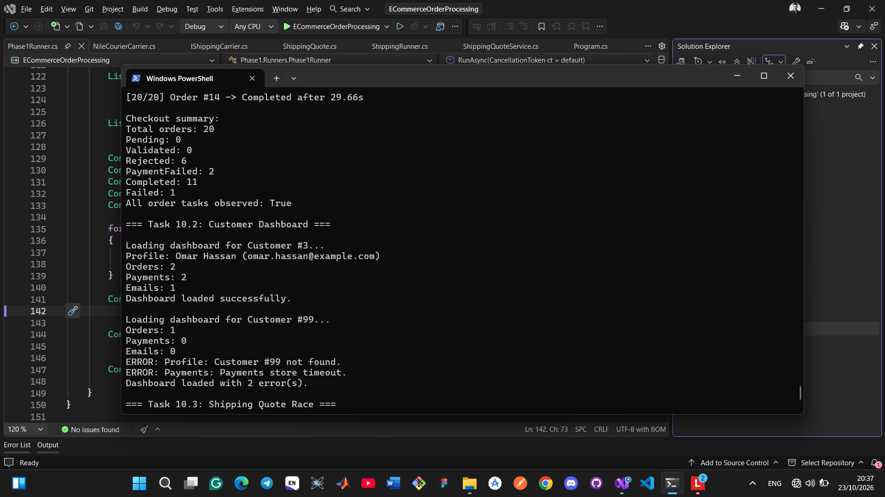
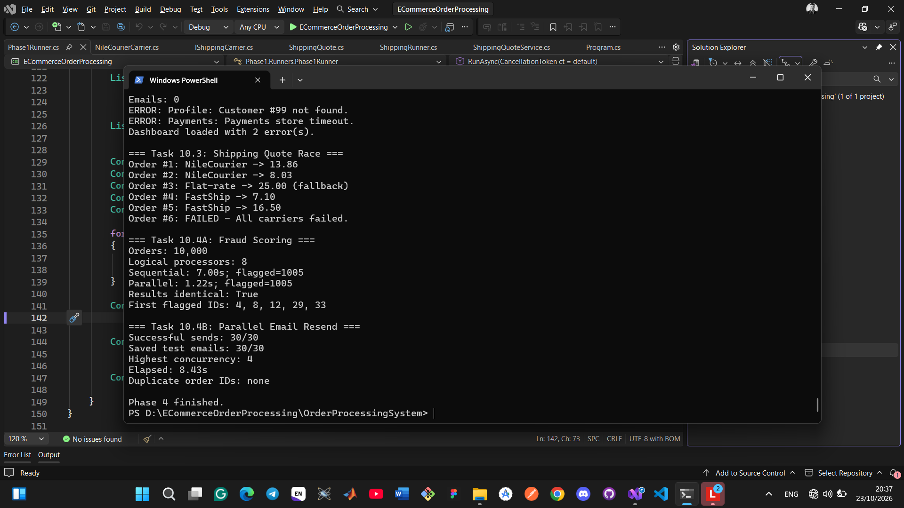

<div align="center">

# E-Commerce Order Processing System
### File Storage Edition — Asynchronous Order Pipeline on .NET 10


</div>

| | |
|---|---|
| **Student** | Tariq Zeyad Khashan |
| **Group** | 1 |
| **Programme** | Simulation Academy — .NET Diploma, Cycle 1 |
| **Assignment** | Async, Threads & Thread Safety — Part 06, Mini Project |
| **Target framework** | `net10.0` |

## Table of Contents

1. [Overview](#1-overview)
2. [Technology and Requirements](#2-technology-and-requirements)
3. [How to Run](#3-how-to-run)
4. [Project Structure](#4-project-structure)
5. [Storage Design](#5-storage-design)
6. [Processing Phases and Console Output](#6-processing-phases-and-console-output)
7. [Concurrency, Reliability and Cancellation](#7-concurrency-reliability-and-cancellation)
8. [Performance Results](#8-performance-results)
9. [Problems Encountered and Solutions](#9-problems-encountered-and-solutions)
10. [Known Limitations](#10-known-limitations)
11. [Answers to the Assignment Questions](#11-answers-to-the-assignment-questions)
12. [Troubleshooting](#12-troubleshooting)

---

## 1. Overview

This project is a C# console application that processes e-commerce orders **asynchronously**. Every order is validated against customer and product data, priced, paid for, saved and confirmed by email. The system has no real database or network: each collection is stored in a JSON file, and every database call, payment and email is simulated with several `Task.Delay()` steps that imitate real latency.

The application is delivered in four phases, each building on the previous one.

| Phase | Subject | Outcome of the reference run |
|:--:|---|---|
| **1** | Asynchronous data access layer and order validation | 15 Validated, 5 Rejected; `orders.json` holds 20 records |
| **2** | Concurrent processing, pricing, race-condition demonstration, invoices and report | 13 Completed, 6 Rejected, 1 Failed |
| **3** | Full checkout: stock, pricing, payment, persistence, email with retry, compensation | 11 Completed, 6 Rejected, 2 PaymentFailed, 1 Failed |
| **4** | Live progress, customer dashboard, fastest shipping quote, fraud scoring, bounded email re-send | 1005 orders flagged identically by the sequential and parallel runs |

The checkout workflow used in Phases 3 and 4 is shown below.



## 2. Technology and Requirements

| Item | Value |
|---|---|
| Language | C# |
| Framework | .NET 10 (`net10.0`), console application |
| Persistence | JSON files via `System.Text.Json` (indented, camelCase, enums stored as text, UTF-8) |
| Language features | Nullable reference types and implicit usings enabled |
| External packages | None (no `PackageReference`), no database, no HTTP calls, no ASP.NET Core |
| Dependency wiring | Manual constructor injection, no DI container |

**Requirements:** the .NET 10 SDK and any terminal (PowerShell, Windows Terminal, Command Prompt).

```powershell
dotnet --list-sdks
```

## 3. How to Run

From the repository root:

```powershell
cd .\06-OrderProcessing\OrderProcessingSystem
dotnet restore
dotnet build
dotnet run
```

`dotnet run` without arguments opens a numbered menu (setup, each phase, the sync/async comparison, the fire-and-forget demonstrations, all phases, exit).

### Command reference

| Command | Purpose |
|---|---|
| `dotnet run` | Interactive menu |
| `dotnet run -- setup` | Delete and recreate the `Data` folder from the seed data |
| `dotnet run -- phase1` | Phase 1: validation, sync vs async |
| `dotnet run -- phase2` | Phase 2: concurrent processing, race demo, report |
| `dotnet run -- phase3` | Phase 3: full checkout of the 20 orders |
| `dotnet run -- phase3-compare` | Task 9.6: synchronous (10 threads) vs asynchronous (10 tasks) |
| `dotnet run -- phase3-fire-and-forget` | Task 9.7: the broken fire-and-forget version |
| `dotnet run -- phase3-fire-and-forget-fixed` | Task 9.7: the corrected version |
| `dotnet run -- phase4` | Phase 4: tasks 10.1 to 10.4 |
| `dotnet run -- all` | Setup, then Phases 1 to 4 in sequence |

### Cancellation

```powershell
dotnet run -- phase3 --cancel-after 4000
```

`--cancel-after <ms>` cancels the run automatically after the given number of milliseconds. Pressing **Ctrl+C** also cancels the run instead of terminating the process: `Program` handles `Console.CancelKeyPress`, sets `e.Cancel = true` and cancels the phase's `CancellationTokenSource`. Cancellation is cooperative: every method receives the token and passes it to its delays and file operations.

> **Note:** `setup` deletes and recreates the runtime `Data` folder. Each phase also starts with `DataSeeder.ResetAsync()`.

### Runtime data folder

The data folder is created at `Path.Combine(AppContext.BaseDirectory, "Data")`, which is `bin/Debug/net10.0/Data` after `dotnet run`. It is generated at runtime and therefore not committed; the final files of each phase are stored in `sample-output/`.

| File / folder | Purpose | Modified during a run |
|---|---|:--:|
| `customers.json` | 10 customers | No |
| `products.json` | 8 products with stock | Yes (reserve / release) |
| `coupons.json` | 4 coupons | No |
| `incoming_orders.json` | 20 seeded orders | No |
| `orders.json` | Processed orders | Yes |
| `payments.json` | Captured, Declined and Refunded transactions | Yes |
| `emails.json` | Email outbox | Yes |
| `email_retry.json` | Emails that failed all attempts | Yes |
| `invoices/` | `invoice_{orderId}.txt` | Yes (Phase 2) |
| `reports/` | `report_{yyyyMMdd_HHmmss}.json` | Yes (Phase 2) |

## 4. Project Structure

```text
06-OrderProcessing/
├── README.md
├── screenshots/
│   ├── phase1.png
│   ├── phase2.png
│   ├── Phase3_A.png
│   ├── Phase3_B.png
│   ├── phase4_A.png
│   └── Phase4_B.png
├── sample-output/                      final JSON files and console output of each phase
│   ├── phase1/  phase2/  phase3/  phase4/
└── OrderProcessingSystem/
    ├── OrderProcessingSystem.csproj
    ├── Program.cs                      menu, argument parsing, cancellation source
    ├── Shared/
    │   ├── Exceptions/                 CustomerNotFound, InvalidCoupon, ShippingProviderUnavailable,
    │   │                               DatabaseWrite, SmtpUnavailable, DataFileCorrupted
    │   ├── Logging/                    Log.cs
    │   ├── Models/                     Customer, Product, Coupon, Order, OrderItem, EmailMessage,
    │   │                               PaymentResult, PaymentTransaction, Report, LoyaltyTier,
    │   │                               OrderStatus, PaymentStatus
    │   └── Storage/                    DataFiles.cs, DataSeeder.cs, JsonFileStore.cs
    ├── Phase1/
    │   ├── Interfaces/                 repository interfaces
    │   ├── Repositories/               Customer, Product, Coupon, Order, IncomingOrder + Sync* twins
    │   ├── Services/                   CustomerService, ProductService, CouponService
    │   ├── Validators/                 OrderValidator, SyncOrderValidator
    │   └── Runners/                    Phase1Runner.cs
    ├── Phase2/
    │   ├── Strategies/                 SubtotalStrategy, DiscountStrategy, ShippingStrategy (+ Interfaces/)
    │   ├── Services/                   PricingService.cs
    │   ├── Pricing/                    OrderPricer.cs
    │   ├── Processors/                 OrderProcessorV2.cs
    │   ├── Invoices/                   InvoiceGenerator.cs
    │   ├── Reports/                    ReportGenerator.cs
    │   ├── Prototypes/                 OrderPrototype.cs (+ Interfaces/)
    │   └── Runners/                    Phase2Runner.cs, RaceConditionDemo.cs
    ├── Phase3/
    │   ├── Interfaces/                 IPaymentGateway, IEmailService
    │   ├── Services/                   CustomerService, InventoryService, PricingService,
    │   │                               PaymentGateway, EmailService
    │   ├── Retry/                      EmailRetryService.cs
    │   ├── Processors/                 OrderProcessor, SyncOrderProcessor, FireAndForgetDemo
    │   └── Runners/                    Phase3Runner, SyncVsAsyncRunner, FireAndForgetRunner
    └── Phase4/
        ├── Checkout/                   LiveCheckoutRunner.cs
        ├── Dashboard/                  CustomerDashboard, CustomerDashboardService, CustomerDashboardRunner
        ├── Shipping/                   IShippingCarrier, FastShip / CairoExpress / NileCourier carriers,
        │                               ShippingQuote, ShippingQuoteService, ShippingRunner
        ├── Fraud/                      FraudScoringService, FraudScoringRunner
        ├── EmailResend/                EmailResendService, EmailResendRunner
        └── Runners/                    Phase4Runner.cs
```

### Class responsibilities

| Area | Classes | Single responsibility |
|---|---|---|
| Entry point | `Program` | Parse arguments, show the menu, own the `CancellationTokenSource`, dispatch a phase |
| Storage | `JsonFileStore` | The only class that reads and writes the JSON files (async and sync API) |
| | `DataFiles` | Constants for file and folder names |
| | `DataSeeder` | Delete the Data folder and recreate every file from the seed data |
| Logging | `Log` | Colour-coded console output with time and thread id, safe across threads |
| Phase 1 | `CustomerRepository`, `ProductRepository`, `CouponRepository`, `IncomingOrderRepository`, `OrderRepository` | Simulated database access; the product repository also reserves and releases stock |
| | `OrderValidator` / `SyncOrderValidator` | The six validation checks, stopping at the first failure |
| | `Phase1Runner` | Reset, sync run, reset, async run, summary read back from `orders.json` |
| Phase 2 | `SubtotalStrategy`, `DiscountStrategy`, `ShippingStrategy` | One pricing rule each |
| | `PricingService`, `OrderPricer` | Price an order; discount and shipping calls run at the same time |
| | `OrderProcessorV2` | Reserve stock, price, generate invoice, complete the order |
| | `InvoiceGenerator` | CPU-bound invoice rendering in `Task.Run`, writes `invoice_{id}.txt` |
| | `ReportGenerator` | Build and save the report |
| | `RaceConditionDemo` | Demonstrate the oversell and its fix |
| Phase 3 | `CustomerService`, `InventoryService`, `PricingService` | Customer lookup, all-or-nothing stock reservation, total pricing |
| | `PaymentGateway` (`IPaymentGateway`) | Capture, decline and timeout simulation; refunds; writes `payments.json` |
| | `EmailService` (`IEmailService`), `EmailRetryService` | Send confirmations; retry with back-off; queue failures |
| | `OrderProcessor`, `SyncOrderProcessor` | The six-step checkout, asynchronous and blocking versions |
| | `Phase3Runner`, `SyncVsAsyncRunner`, `FireAndForgetDemo`, `FireAndForgetRunner` | Phase 3 scenarios and demonstrations |
| Phase 4 | `LiveCheckoutRunner` | Task 10.1: report each order as it finishes |
| | `CustomerDashboardService` | Task 10.2: four concurrent loads, all failures reported |
| | `ShippingQuoteService` and three carriers | Task 10.3: fastest successful quote wins, losers cancelled |
| | `FraudScoringService` | Task 10.4 A: CPU-bound scoring, sequential and parallel |
| | `EmailResendService` | Task 10.4 B: 30 emails with at most four in flight |

## 5. Storage Design

**Format.** One JSON file holds one array. A single shared static `JsonSerializerOptions` is used (`WriteIndented`, camelCase, `JsonStringEnumConverter`), so a status is stored as text (`"Completed"`). Files are UTF-8, and an empty collection is stored as `[]`.

**`JsonFileStore` API.** A static class that accepts file *names* only. Paths and names ending in `.tmp` are rejected, so a caller cannot write outside the Data folder.

| Method | Used by |
|---|---|
| `Task<List<T>> ReadAsync<T>(fileName, ct)` | All asynchronous code |
| `Task WriteAsync<T>(fileName, List<T>, ct)` | All asynchronous code |
| `List<T> Read<T>(fileName)`, `void Write<T>(fileName, List<T>)` | Only the synchronous comparison classes |

The store works on whole collections (read the list, modify it, write it back), which matches the "one file, one array" design. It contains no simulated delays; all latency belongs to repositories and services.

### Correctness under concurrent access

| Layer | Mechanism | Prevents |
|:--:|---|---|
| **Store** | One `SemaphoreSlim(1,1)` around every read and write | Two tasks touching the same file at the same instant |
| **Operation** | A lock around the whole read-modify-write: `StockLock`, `SaveLock`, `PaymentLock`, `EmailLock`, `RetryLock` | A lost update (A reads, B reads, A writes, B overwrites A) |
| **Crash safety** | Write to `{file}.{guid}.tmp`, then `File.Move(..., overwrite: true)` | A half-written file if the process stops during a write |

A missing file returns an empty collection. Invalid JSON raises `DataFileCorruptedException`, whose message contains the file name and which keeps the original `JsonException` as its inner exception. The lock coordinates access within the current process; it is not a cross-process file lock.

<details>
<summary><b>Code: atomic write</b> (<code>JsonFileStore.Write</code>, synchronous twin)</summary>

```csharp
public static void Write<T>(string fileName, List<T> records)
{
    ArgumentNullException.ThrowIfNull(records);

    FileLock.Wait();                                   // one file operation at a time
    string? tempPath = null;
    try
    {
        Directory.CreateDirectory(DataDirectory);
        string path = GetPath(fileName);
        tempPath = path + $".{Guid.NewGuid():N}.tmp";  // never write over the real file directly

        string json = JsonSerializer.Serialize(records, JsonOptions);
        File.WriteAllText(tempPath, json);

        File.Move(tempPath, path, overwrite: true);    // swap in the finished file
        tempPath = null;
    }
    finally
    {
        try { DeleteTempFile(tempPath); }              // clean up after a failure
        finally { FileLock.Release(); }
    }
}
```

The asynchronous version performs the same steps and moves the file with `MoveFileAsync`, which retries up to three times (100 ms apart) on `IOException` and `UnauthorizedAccessException`.
</details>

<details>
<summary><b>Code: stock reservation as one atomic step</b> (<code>ProductRepository.ReserveStockAsync</code>, trimmed)</summary>

```csharp
await StockLock.WaitAsync(ct);                  // SemaphoreSlim can be awaited; lock cannot
try
{
    await SimulateTransactionAsync(ct);

    List<Product> products = await JsonFileStore.ReadAsync<Product>(DataFiles.Products, ct);
    Product? product = products.FirstOrDefault(p => p.Id == productId);

    if (product is null || product.StockQuantity < qty)
        return false;

    product.StockQuantity -= qty;
    await Task.Delay(UpdateDelayMilliseconds, ct);
    await JsonFileStore.WriteAsync(DataFiles.Products, products, ct);
    await Task.Delay(CommitDelayMilliseconds, ct);
    return true;
}
finally
{
    StockLock.Release();
}
```
</details>

## 6. Processing Phases and Console Output

> Each screenshot below was captured from a run of the application in PowerShell. Timings differ slightly between runs (random simulated latency); see [Performance Results](#8-performance-results).

### Phase 1 — Asynchronous data access and validation

**Entry point:** `Phase1/Runners/Phase1Runner.cs`

Repositories read and write the JSON files after at least two simulated delay steps. `OrderValidator` applies six checks in a fixed order and stops at the first failure (customer exists, customer active, products exist, stock sufficient, coupon exists, coupon not expired). Passing orders become `Validated`; failing orders become `Rejected` with the exact reason, and both are saved to `orders.json`. The runner validates all 20 orders once synchronously (`Thread.Sleep`, not saved) and once asynchronously (awaited one by one, saved), then reads the counts back from `orders.json`.

<p align="center"></p>

*Figure 1. Phase 1 output: 15 orders validated, 5 rejected with the required reasons (#4 inactive customer, #9 insufficient stock for 'Wireless Mouse', #12 expired coupon, #15 unknown customer, #18 unknown coupon). `orders.json` contains 20 records. Sync time 35.3 s, async time 52.8 s.*

### Phase 2 — Concurrent processing

**Entry point:** `Phase2/Runners/Phase2Runner.cs`

| Component | Role |
|---|---|
| `SubtotalStrategy`, `DiscountStrategy`, `ShippingStrategy` | Pricing rules: loyalty 0/5/10 % plus coupon %, capped at 30 %; shipping `5.00 + 1.50 × quantity + 2.00 × kg`, free from a subtotal of 1000 |
| `OrderPricer` | Calculates the subtotal first, then runs discount and shipping at the same time (a sequential version exists for timing) |
| `RaceConditionDemo` | Two orders compete for the last Mechanical Keyboard: unsafe reservation vs protected reservation |
| `OrderProcessorV2` | Reserve stock, price, generate the invoice, complete |
| `InvoiceGenerator` | 20,000,000-iteration CPU loop inside `Task.Run`, then writes the invoice file |
| `ReportGenerator` | Totals, revenue, average order value and best-selling product |

Order #7 is configured so that its shipping call fails; the failure is isolated, the order is saved as `Failed`, and the other orders continue.

<p align="center"></p>

*Figure 2. Phase 2 output: final status of every order (13 Completed, 6 Rejected, 1 Failed), 20 records in `orders.json`, concurrent processing time 23711 ms, followed by report generation.*

<details>
<summary><b>Race-condition demonstration (console excerpt)</b></summary>

```text
Unsafe reservation demo
Order #10: Reservation successful
Order #11: Reservation successful        <-- both received the only keyboard
Keyboard stock remaining: 0

Safe reservation demo
Order #10: Reservation successful
Order #11: Reservation failed            <-- protected by StockLock
Keyboard stock remaining: 0
```

Report of the reference run: total revenue 5970.95, average order value 459.30, top-selling product USB-C Hub (5 units).
</details>

### Phase 3 — Full checkout workflow

**Entry point:** `Phase3/Runners/Phase3Runner.cs`

`OrderProcessor.ProcessOrderAsync` runs the six steps shown in the workflow diagram, logs each step with its own duration, and always saves the order with its final status, so `orders.json` ends with 20 records. Failures are injected through constructors, so the processing code never inspects order ids.

| Order | Scenario | Configured by | Observed result |
|:--:|---|---|---|
| 15 | Customer does not exist | Real data (customer 99) | Rejected: `Customer #99 not found` |
| 5 | Payment timeout | `PaymentGateway(timeoutOrderIds)` | PaymentFailed: `Payment gateway timeout (3s)`, stock released, no payment record |
| 8 | Payment declined | `PaymentGateway(declineOrderIds)` | PaymentFailed: `Card declined by issuer` |
| 13 | Database failure after payment | `OrderRepository(failSaveForOrderIds)` | Failed: payment refunded, stock released |
| 3 | Email fails twice | `EmailService(failAttempts)` | Completed; sent on attempt 3 |
| 17 | Email always fails | `EmailService(failAttempts)` | Completed; queued in `email_retry.json` after attempt 4 |

Email retry waits 500, 1000 and 2000 ms before retries 1 to 3; a failed email never changes the status of a paid order.

<p align="center"></p>

*Figure 3. Phase 3 final results: 20 orders loaded, 11 Completed, 6 Rejected, 2 PaymentFailed (#5 timeout, #8 declined), 1 Failed (#13, refunded). Elapsed time 28.86 s. The table lists each order with its total and failure reason (orders 1 to 16 visible).*

<p align="center"></p>

*Figure 4. Phase 3 file validation: `orders.json` has 20 records; `payments.json` has 13 (11 Captured, 1 Declined, 1 Refunded); 10 emails sent and 1 queued for retry.*

**Synchronous vs asynchronous (Task 9.6).** Orders #1 to #10 were processed with failures disabled by `SyncOrderProcessor` (one dedicated thread per order) and by the asynchronous `OrderProcessor` (one task per order). Both produced 8 Completed and 2 Rejected (#4, #9).

**Fire-and-forget (Task 9.7).** `FireAndForgetDemo` starts the email without awaiting it. The fixed version awaits it.

```text
=== BROKEN: FIRE-AND-FORGET ===            === FIXED: AWAIT ===
Starting fire-and-forget email...          Starting awaited email...
Workflow finished without waiting ...      Email sent successfully.
Runner finished.                           Email operation finished.
                                           Runner finished.
```

### Phase 4 — Scale-up

**Entry point:** `Phase4/Runners/Phase4Runner.cs`

| Task | Component | Behaviour |
|:--:|---|---|
| 10.1 | `LiveCheckoutRunner` | Starts all 20 checkouts at once and prints one line per order the moment it finishes, with a counter up to `[20/20]` |
| 10.2 | `CustomerDashboardService` | Four loads (profile, orders, payments, emails) at the same time; every failure is reported |
| 10.3 | `ShippingQuoteService`, `FastShipCarrier`, `CairoExpressCarrier`, `NileCourierCarrier` | All carriers asked at once; first successful quote wins; the others are cancelled; 1.2 s budget with a flat-rate fallback of 25.00 |
| 10.4 A | `FraudScoringService` | 10,000 CPU-bound scores, sequential and parallel; identical result of 1005 flagged orders |
| 10.4 B | `EmailResendService` | 30 emails with at most four sends at the same time |

<p align="center"></p>

*Figure 5. Tasks 10.1 and 10.2: the last live-checkout line (`[20/20]`, 29.66 s) and the status summary (6 Rejected, 2 PaymentFailed, 11 Completed, 1 Failed), followed by the dashboards of customer #3 (2 orders, 2 payments, 1 email) and of customer #99, which reports both failures: `Customer #99 not found` and `Payments store timeout`.*

<p align="center"></p>

*Figure 6. Tasks 10.3 and 10.4: shipping winners per order (order #3 exceeded the 1.2 s budget and received the flat-rate fallback of 25.00; order #6 failed because all carriers failed), fraud scoring (sequential 7.00 s, parallel 1.22 s, 1005 flagged, identical results), and email re-send (30/30 sent, highest concurrency 4, 8.43 s, no duplicates).*

<details>
<summary><b>Additional console excerpts</b> (payment timeout, refund, email retry, cancelled run)</summary>

```text
# Order #5: the capture would take 5 s, the checkout allows 3 s
Order #5 -> 4/6 Payment CANCELLED in 3008 ms
5   5   PaymentFailed   331.50   Payment gateway timeout (3s)

# Order #13: payment captured, database commit fails, compensation runs
Order #13 -> 5/6 Save FAILED ... | Connection lost during commit
13  3   Failed   309.20   Database save failed after payment; payment TXN-... refunded

# Orders #3 and #17: email retry
Order #3 email attempt 1/4 failed ...
Order #3 email attempt 2/4 failed ...
Order #3 email sent successfully on attempt 3.
Order #17 email attempt 4/4 failed ...
Email for Order #17 queued for retry later       <-- order remains Completed

# Cancelled run
$ dotnet run -- phase3 --cancel-after 4000
Orders loaded: 20
Starting concurrent processing...

Run cancelled.
```
</details>

## 7. Concurrency, Reliability and Cancellation

| Concern | Approach |
|---|---|
| Lost updates in shared files | Per-operation locks (`SemaphoreSlim`) around each read-modify-write, plus one store-level lock |
| Corrupted files after a crash | Temporary file followed by an atomic replace |
| Overselling stock | Check and write performed as one step under `StockLock`; the checkout reserves all items or none and rolls back on failure |
| Payment timeout | Linked `CancellationTokenSource` with a 3 s limit; a timeout is distinguished from cancellation of the whole run |
| Payment succeeded but save failed | Compensation: refund, release stock, mark the order `Failed` |
| Email failure | Retry with back-off, then queue to `email_retry.json`; the order status never changes |
| Several failures in one operation | The dashboard inspects every task's exception instead of rethrowing only the first |
| Cancellation | Every async method takes a `CancellationToken` as its last parameter and passes it to delays and file operations; `Program` catches `OperationCanceledException` and prints `Run cancelled.` |

Logging is centralised in `Log`, which prints `[HH:mm:ss.fff] [Thread N]` followed by the message and serialises console writes so that colours from different threads never mix.

<details>
<summary><b>Code: payment with a 3-second limit</b> (<code>OrderProcessor</code>, trimmed)</summary>

```csharp
using (var timeoutCts = new CancellationTokenSource())
using (var linkedCts = CancellationTokenSource.CreateLinkedTokenSource(ct, timeoutCts.Token))
{
    timeoutCts.CancelAfter(TimeSpan.FromSeconds(3));
    try
    {
        payment = await ExecuteStepAsync(order.Id, "4/6 Payment",
            () => _paymentGateway.ProcessPaymentAsync(order.Id, order.TotalAmount, linkedCts.Token));
    }
    catch (OperationCanceledException)
        when (!ct.IsCancellationRequested && timeoutCts.IsCancellationRequested)
    {
        // the 3-second timer fired and the user did not cancel: this is a timeout
    }
}
```
</details>

<details>
<summary><b>Code: library-controlled concurrency in Phase 4</b> (trimmed)</summary>

```csharp
// 10.4 A, CPU-bound: spread over all cores, collect ids without loss or duplication
var flagged = new ConcurrentBag<int>();
Parallel.For(1, orderCount + 1,
    new ParallelOptions { CancellationToken = ct, MaxDegreeOfParallelism = Environment.ProcessorCount },
    orderId => { if (IsFlagged(orderId)) flagged.Add(orderId); });

// 10.4 B, I/O-bound: the library enforces at most 4 at once; Interlocked only measures the peak
await Parallel.ForEachAsync(orders, options /* MaxDegreeOfParallelism = 4 */, async (order, ct) =>
{
    int nowActive = Interlocked.Increment(ref active);
    UpdateMaximum(ref highestConcurrent, nowActive);
    try
    {
        await Task.Delay(TimeSpan.FromSeconds(1), ct);
        await _emailService.SendConfirmationAsync(order, customer, ct);
    }
    finally { Interlocked.Decrement(ref active); }
});
```
</details>

## 8. Performance Results

Environment: 8 logical processors. *Distinct threads* is counted from the `[Thread N]` identifiers in each run's log. `ThreadPool.ThreadCount` is printed by the Phase 3 comparison run only. Values marked *derived* follow from the code rather than a stopwatch.

### Reference run (`sample-output/`)

| Scenario | Time | Distinct threads | ThreadPool.ThreadCount | Source |
|---|--:|:--:|:--:|:--:|
| Phase 1 — synchronous, 20 orders one by one | 34.1 s | 1 | n/a | measured |
| Phase 1 — asynchronous, 20 orders one by one, with save | 55.8 s | 4 | n/a | measured |
| Phase 2 — pricing one order, sequential | 3668 ms | 2 | n/a | measured |
| Phase 2 — pricing one order, concurrent | 2412 ms | 1 | n/a | measured |
| Phase 2 — validate and save 20 orders concurrently | 19857 ms | 9 | n/a | measured |
| Phase 2 — process all validated orders concurrently | 24858 ms | 6 | n/a | measured |
| Phase 3 — synchronous, 10 dedicated threads (orders 1 to 10) | 1.75 s | 10 own threads | 4 → 4 | measured |
| Phase 3 — asynchronous, 10 tasks (orders 1 to 10) | 16.67 s | process threads 14 → 20 | 4 → 9 | measured |
| Phase 3 — full checkout, 20 orders | 28.14 s | 10 | n/a | measured |
| Phase 4 — 10.1 live checkout, 20 orders | 31.48 s (first line at 1.74 s) | 9 | n/a | measured |
| Phase 4 — 10.2 dashboard | about 100 ms of waiting plus file reads, against about 400 ms if awaited one by one | a few pool threads | n/a | derived |
| Phase 4 — 10.3 shipping quote per order | never above the 1.2 s budget | one pool thread per carrier | n/a | derived |
| Phase 4 — 10.4 A fraud scoring, sequential | 7.76 s | 1 | n/a | measured |
| Phase 4 — 10.4 A fraud scoring, parallel | 1.15 s (6.7× faster) | up to 8 | n/a | measured / derived |
| Phase 4 — 10.4 B email re-send, 30 emails, at most 4 at once | 8.83 s | peak of 4 sends in flight | n/a | measured |

### Repeat run (captured in the screenshots)

| Scenario | Time |
|---|--:|
| Phase 1 — synchronous / asynchronous | 35.3 s / 52.8 s |
| Phase 2 — concurrent processing of all validated orders | 23711 ms |
| Phase 3 — full checkout, 20 orders (revenue 4583.75) | 28.86 s |
| Phase 4 — live checkout, last order finished | 29.66 s |
| Phase 4 — fraud scoring, sequential / parallel | 7.00 s / 1.22 s (5.7× faster) |
| Phase 4 — email re-send, 30 emails | 8.43 s (highest concurrency 4) |

The two runs agree closely. Differences come from the random simulated latency. The Phase 3 revenue differs by 4.50 (4588.25 vs 4583.75) because orders #10 and #11 compete for the last keyboard: either may win, and the two carts have different totals (93.80 and 89.30). Both outcomes are valid.

### Interpretation

- **Phase 1:** the asynchronous run is slower because only it saves each order, at about one second of simulated database steps per order. Awaiting orders one after another cannot beat the synchronous run.
- **Phase 2 vs Phase 1:** the same validate-and-save job takes 55.8 s sequentially and 19.9 s concurrently. It does not fall further because the 20 saves are serialised by `SaveLock` (about one second each).
- **Fraud scoring:** the parallel speed-up (6.7× on 8 logical processors) is close to the ideal 8×.
- **Email re-send:** 30 emails at four per round is 7.5 rounds of about one second, which matches the measured 8.83 s.
- **Synchronous vs asynchronous (Task 9.6):** both versions produce identical results (8 Completed, 2 Rejected). The synchronous implementation models fewer delay steps than the asynchronous one, so the absolute times are not directly comparable. The thread figures show the difference in resource use: ten synchronous orders require ten dedicated, mostly sleeping threads, whereas the asynchronous run used a few shared pool threads (the pool grew from 4 to 9).

## 9. Problems Encountered and Solutions

| # | Problem | Cause | Solution |
|:--:|---|---|---|
| 1 | Two orders received the last Mechanical Keyboard | The unsafe reservation reads the stock, waits, then writes (check-then-act) | `ReserveStockAsync` and `ReleaseStockAsync` perform check and write inside `StockLock`; the demo now yields one `true`, one `false`, stock 0 |
| 2 | Updates to `orders.json`, `payments.json` and `emails.json` could be lost | A read-modify-write consists of two store calls; the store lock protects only each call | One lock per read-modify-write path around the full sequence |
| 3 | A crash could leave a half-written JSON file | Writing directly over the real file | Write a temporary file, replace the original with `File.Move`, retry on `IOException`, delete the temporary file in `finally` |
| 4 | A lock was needed around code containing `await` | `lock` (`Monitor`) must be released by the thread that acquired it, but an `await` may resume on another thread | `SemaphoreSlim.WaitAsync` in all asynchronous code; `lock` only in the blocking classes |
| 5 | A payment timeout was indistinguishable from cancelling the run | Both raise `OperationCanceledException` | Linked `CancellationTokenSource` with a 3 s limit; it is a timeout only when the timeout source fired and the caller's token did not |
| 6 | A paid order must not appear failed because of an email error | The email is the last step, after money has moved | Retry with back-off, then queue to `email_retry.json` and return normally (order #17 stays Completed) |
| 7 | Database error after a successful payment | Payment and save are separate systems | Compensation: refund, release stock, mark `Failed` (order #13) |
| 8 | Console lines from different threads mixed colours | Several threads changed `Console.ForegroundColor` concurrently | `Log` writes inside a lock and restores the original colour in `finally` |
| 9 | The dashboard reported only the first failure | `await Task.WhenAll` rethrows a single exception | The `WhenAll` exception is intentionally swallowed and every task is inspected, so customer #99 shows both errors |
| 10 | Concurrent processing was slower than expected (about 19.9 s for 20 saves) | Saves are serialised by `SaveLock`, about one second each | The lock was kept: correctness of `orders.json` takes priority over speed. The measurement matches the explanation |

## 10. Known Limitations

- **Synchronous comparison (Task 9.6):** `SyncOrderProcessor` models fewer delay steps than the asynchronous processor, so its absolute time is lower than a faithful synchronous copy would give. Statuses and totals match exactly.
- **Phase 1 timing:** the asynchronous run is slower than the synchronous run because it also saves every order.
- **Cancellation:** a cancelled run stops at the next awaited step and prints `Run cancelled.`. The processor refunds a captured payment and releases reserved stock, but a cancelled order is saved with a "cancelled" failure reason (status `Failed`) rather than `Pending`, and the `{n} finished, {m} cancelled` summary line is not printed.
- **Wording:** some failure messages inside the checkout differ slightly from the assignment text (for example `Insufficient stock for one or more products`, `Coupon 'X' was not found.`). The Phase 1 validator uses the exact wording.
- **Phase 4 timing:** the dashboard and shipping runners do not print a stopwatch value; those two rows in the performance table are derived from the code.

---

## 11. Answers to the Assignment Questions

<details>
<summary><b>Phase 1</b> (5 questions)</summary>
<br>

**1. Why are the sync and async times almost the same when orders are awaited one after another?**
Because awaiting one order before starting the next means the waits still happen one after another. `await` only frees the *thread* during a wait; it does not shorten the wait. In my run async was actually slower (55.8 s vs 34.1 s) since it also saved each order, which costs about one second of simulated database steps per order. Async pays off when waits overlap, not when they are chained.

**2. Is the thread ID before an await always the same as after it? Why?**
No. In my async log, `Executing query for Customer #1` runs on Thread 5 and the next line, `Customer #1 found`, runs on Thread 12. When `Task.Delay` finishes, the rest of the method is scheduled on whichever pool thread is free, and a console app has no synchronization context to bring it back. In the sync run every line shows Thread 5 because the thread never leaves.

**3. What does the thread do while `Task.Delay()` waits? And while `Thread.Sleep()` waits?**
With `Task.Delay` the method returns to its caller and the thread goes back to the pool to run other work; a timer resumes the method later. With `Thread.Sleep` the thread is blocked and does nothing useful until the time is up, which is why the sync version needs one full thread per order.

**4. Why should a repository method return `Task<T>` instead of `T`?**
Because the result is not ready when the method returns: a database call takes time. `Task<T>` lets the caller `await` without blocking, compose several calls, pass a cancellation token, and receive failures as exceptions on the task. Returning plain `T` would force the caller to block a thread until the data arrives.

**5. `File.ReadAllText` vs `File.ReadAllTextAsync`: does the async version occupy a thread while the disk reads?**
`ReadAllText` blocks the calling thread for the whole read. `ReadAllTextAsync` returns a task and the operating system's asynchronous I/O completes it, so no thread is held during the disk wait; a pool thread is only needed briefly to continue afterwards.
</details>

<details>
<summary><b>Phase 2</b> (8 questions + 2 extras)</summary>
<br>

**1. What is the difference between starting a task and awaiting it?**
Starting a task begins the work and gives me a `Task` object while my code keeps running. Awaiting it pauses my method until the task finishes and hands me its result or exception. In Phase 2 I start the work for every validated order first (my log shows the first task as `WaitingForActivation` right after creation), and only then wait for the results.

**2. Does every `Task` create a new thread? Does `Task.Delay()` use a thread while waiting?**
No. Most tasks are just a state machine waiting for something, and my 20 concurrent orders ran on only 6 different threads. `Task.Delay` uses a timer, so nothing is occupied while it waits; a pool thread is borrowed only to run the continuation.

**3. What happens if I call `.Result` or `.Wait()` on an unfinished task? Why is it dangerous?**
The calling thread blocks until the task finishes. If the task needs that same thread (or a synchronization context) to continue, neither can proceed: a deadlock. Even without a deadlock it wastes a thread, and errors come wrapped in an `AggregateException`. My project follows the rule: it never blocks on an unfinished task. The only `.Result` is in `CustomerDashboardService.GetResult`, guarded by a check that the task already ran to completion. The only blocking waits are `FileLock.Wait()` inside the synchronous store methods, which exist for the sync comparison classes.

**4. What happens to an exception thrown inside a task that is never awaited?**
It is stored in the task and nobody observes it, so the caller keeps going as if nothing happened and the error is silently lost. That is exactly why the fire-and-forget demo hides failures, and why my runners observe every task: order #7's failure was reported as `Faulted` and handled.

**5. When should I use `Task.Run()`, and when should I avoid it?**
Use it for CPU-bound work that would otherwise hog the calling thread, like my invoice rendering loop of 20,000,000 iterations. Avoid it for I/O (database, file, network): those calls are already asynchronous and wrapping them in `Task.Run` just parks a pool thread in a wait.

**6. What is the difference between `Task` and `Task<T>`?**
`Task` is work that produces no value; `Task<T>` produces a value of type `T` when it completes. Both can be awaited and both can fault or be cancelled; only `Task<T>` has a result to read.

**7. Why can a `lock` block not contain an `await`?**
`lock` is built on `Monitor`, and a monitor must be released by the thread that took it. After an `await` the method may resume on a different thread, so the release would be invalid, and the lock would also stay held for the whole wait. The compiler forbids it. I used `SemaphoreSlim` with `WaitAsync()`, which is not tied to a thread.

**8. Why did the unprotected stock reservation oversell, and how did I prevent it?**
Both orders read stock = 1 before either wrote the new value, so both passed the check and both "bought" the keyboard (my demo printed two successes). The fix makes *check and write one atomic step*: `ReserveStockAsync` takes `StockLock`, re-reads the file inside it, checks, writes, and only then releases. The second order now sees 0 and gets `false`.

**Extra 1: why `Task.Run()` fits `InvoiceGenerator` but not the database calls (Task 8.5).**
The invoice loop keeps a CPU core busy the whole time, so moving it to the pool keeps the caller free. A database call is mostly waiting on something outside the CPU; `await` already handles that without any thread, so `Task.Run` would only add a thread that sits idle.

**Extra 2: Phase 2 total time vs Phase 1.**
Phase 1 validated and saved the 20 orders one after another in 55.8 s. In Phase 2 the same validate-and-save job ran concurrently in 19.9 s, and the full processing of all validated orders took 24.9 s. The remaining time is mostly the 20 saves, which are serialized on purpose by `SaveLock`.
</details>

<details>
<summary><b>Phase 3</b> (Task 9.6 and the fire-and-forget investigation 9.7)</summary>
<br>

**Task 9.6: sync vs async**

1. **Does async make one order's workflow faster?** No. A single order still goes through the same delays one after another, so its own time is about the same. Async changes how many orders can be in progress at once, not how long one takes.
2. **Why does async scale better for many orders?** A waiting order holds no thread, so a few pool threads serve many orders. In my comparison the 10 sync orders each needed their own thread, while the async run grew the pool only from 4 to 9.
3. **What happens to the sync version with 1,000 orders?** It would need 1,000 threads that mostly sleep. Each costs memory (about 1 MB of stack) and context switching, and the pool only adds threads slowly, so the app becomes slow and could run out of resources.
4. **Why is async essential for apps that call databases, files and APIs?** Those calls are almost entirely waiting. With async the same few threads keep handling other requests during the wait instead of being frozen, which is what lets a server handle many users.

**Task 9.7: fire-and-forget**

- **The problem.** The email task is started but not awaited. The method reports "finished" while the email is still being sent, and nobody ever learns whether it worked.
- **When the method returns or the app exits first.** The broken version printed `Workflow finished without waiting for the email.` and `Runner finished.`; the line confirming the email never appeared, because the process ended before the 3-second email completed.
- **When the email throws.** The exception is stored in a task nobody observes, so nothing is logged and the caller believes everything worked.
- **The fix.** `RunFixedAsync` awaits the email inside `try/catch`, so the workflow waits and failures are reported. The fixed run prints `Email sent successfully.` before `Runner finished.`
- **When `await` is necessary.** Whenever the result, the exception or the completion matters. A paid order needs to know whether its confirmation went out.
- **When fire-and-forget is acceptable.** Only for work whose failure truly does not matter, and even then the task should catch and log its own errors and the app must still be alive to run it.
- **Why `async void` is dangerous.** It cannot be awaited, and an exception thrown inside it is raised on the synchronization context or the thread pool, where it can crash the whole process.
- **Why it is acceptable for event handlers.** Event handler signatures return `void` and the framework is the caller, so there is nobody to await it; the handler must handle its own exceptions.
</details>

<details>
<summary><b>Phase 4</b> (6 questions)</summary>
<br>

**1. Which tool for each of Tasks 10.1 to 10.4, and why can't "start, then await one by one" meet the requirement?**

| Task | Tool I used | Why awaiting one by one fails |
|---|---|---|
| 10.1 live progress | `Task.WhenAny` in a loop: each time one order finishes it is printed and removed from the pending list | Awaiting in start order prints orders in start order, and a fast order would wait behind a slow one. A cleaner tool for this exact need is `Task.WhenEach`, which yields tasks as they complete without me maintaining a pending list |
| 10.2 dashboard | `Task.WhenAll` over the four loads | One by one, the time is the sum of the four loads; with `WhenAll` it is about the slowest single load |
| 10.3 fastest quote | `Task.WhenAny` in a loop + a linked `CancellationTokenSource` + `Task.Delay(1200)` as the time budget | Awaiting carriers in order cannot pick the *first* to answer, cannot ignore a failed first finisher, and cannot cancel the losers |
| 10.4 A fraud scoring | `Parallel.For` with `MaxDegreeOfParallelism = Environment.ProcessorCount` and a `ConcurrentBag` | 10,000 CPU-heavy scores one at a time use one core; the library spreads them over all cores, and the bag collects ids without losing or duplicating any |
| 10.4 B email re-send | `Parallel.ForEachAsync` with `MaxDegreeOfParallelism = 4` | The library enforces "at most 4 at once"; awaiting one by one would send only 1 at a time and take about 30 s |

**2. In 10.2, how do I get every exception when several loads fail? What does a plain `await` give?**
I keep the four task variables, let `Task.WhenAll` finish (its exception is intentionally swallowed), and then read each task's own `Exception`, flattened. A plain `await Task.WhenAll(...)` rethrows only the first inner exception, so with two failures I would see one and silently lose the other. That is why customer #99 shows both `Customer #99 not found` and `Payments store timeout`.

**3. In 10.3, what happens to the losing carriers if I never cancel them?**
They keep running until their own delay ends, holding timers and memory for a quote nobody will use, and their log lines show up after the answer was already returned. Under load, that wasted work piles up. I cancel them through the linked token the moment a quote is chosen.

**4. Why does 10.4 A get faster with more CPU cores, while 10.4 B does not depend on the number of cores?**
10.4 A is CPU-bound: every core can compute scores at the same time, so more cores means more work per second (7.76 s sequential vs 1.15 s on my 8 logical processors). 10.4 B is I/O-bound: the time is spent waiting for simulated sends, and the limit of 4 at once decides the total (30 emails / 4 at a time is about 8 s), no matter how many cores exist.

**5. What is the difference between parallel work (10.4 A) and concurrent asynchronous work (10.1)?**
Parallel work uses several threads running at the same instant to use several CPU cores. Concurrent async work overlaps *waiting*: many orders are in progress at once, but most are idle awaiting a delay or a file, and only a few threads ever execute code (9 distinct threads served 20 orders in 10.1).

**6. A cancelled run (`--cancel-after`): what happened to the orders, the stock and the payments?**
I ran `dotnet run -- phase3 --cancel-after 4000`. After 4 seconds the token was cancelled, every order in progress stopped at its next awaited step, no new step started, and the program printed `Run cancelled.` The cancellation handling in `OrderProcessor` refunds a payment that was already captured and releases reserved stock, and the JSON files stay valid because every write goes through a temp file and a move. What I did not fully implement is the brief's exact end state (orders saved as Pending with the reason "Cancelled", and the `{n} finished, {m} cancelled` line); my implementation saves a cancelled order with a "cancelled" failure reason instead.
</details>

---

## 12. Troubleshooting

| Symptom | Resolution |
|---|---|
| `dotnet` is not recognised | Install the .NET 10 SDK, open a new terminal and run `dotnet --list-sdks` |
| Unknown phase or arguments ignored | Use the double dash: `dotnet run -- phase1`. The `--` separates `dotnet run` options from application arguments |
| Unexpected or missing data | Run `dotnet run -- setup`. This deletes and recreates the runtime `Data` folder |
| `DataFileCorruptedException` | A JSON file is malformed. If the data is disposable, run `setup`; otherwise back up the file before editing it |
| A cancelled run does not stop immediately | Cancellation is cooperative; an operation stops at its next await that observes the token |

<div align="center"><sub>Tariq Zeyad Khashan | Group 1 | Simulation Academy, .NET Diploma, Cycle 1</sub></div>